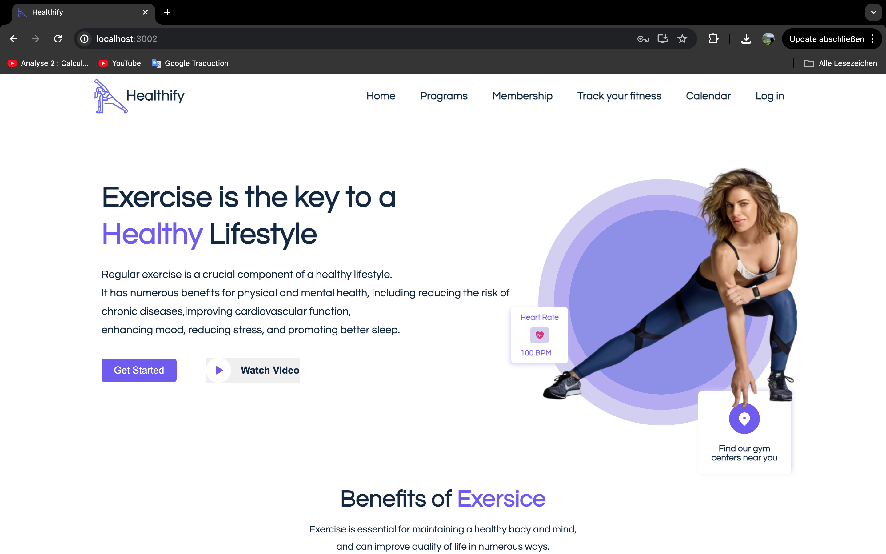
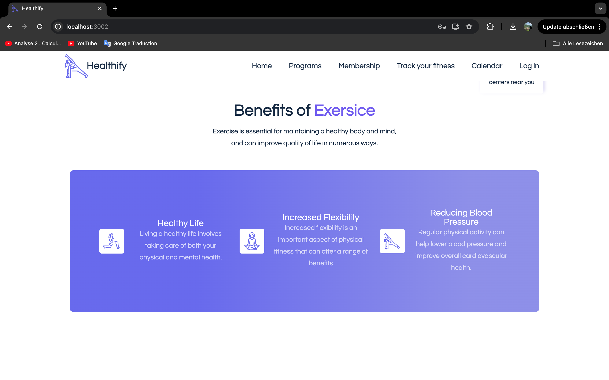
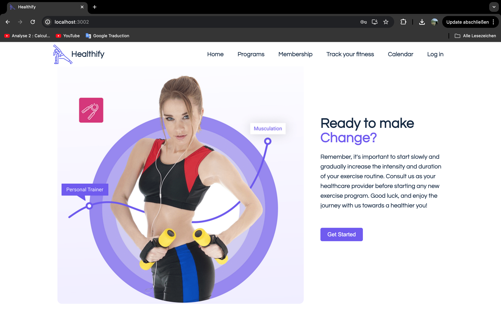
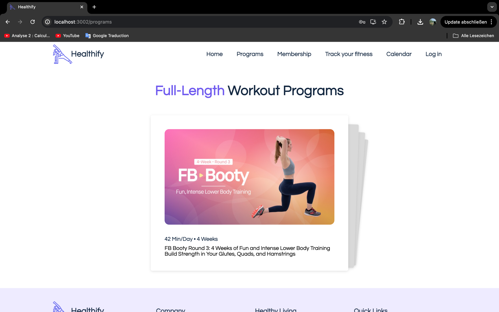
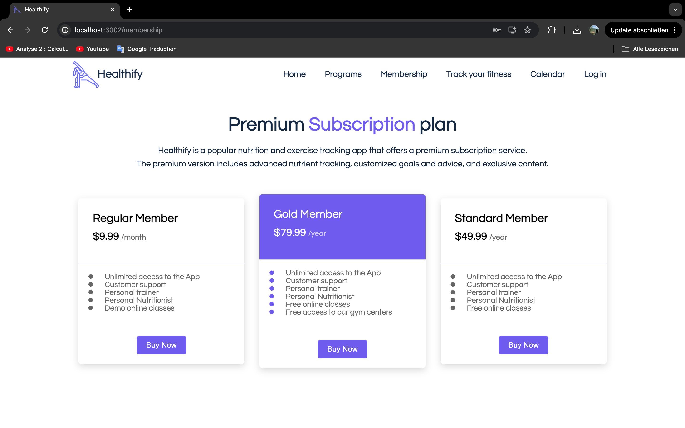
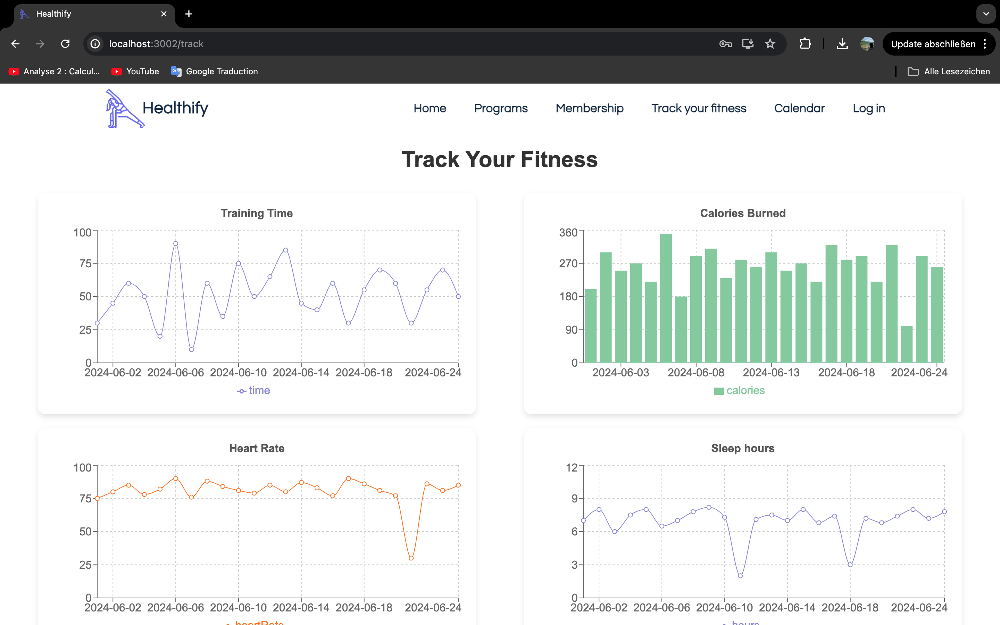
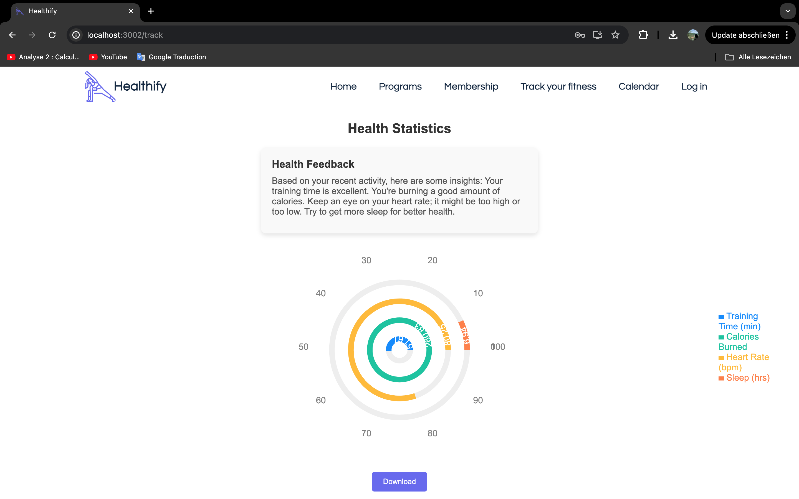
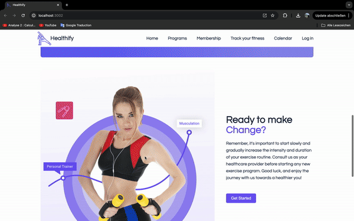

# Team 2:  
# Healthify Project ᕙ(  •̀ ᗜ •́  )ᕗ

This project is aimed at tracking fitness data and providing health insights based on user activities such as training time, calories burned, heart rate, and sleep hours.

## Local setup

This is a hackathon prototype, not a production health service. Use test data only.
The frontend is in `frontend/healthify`; the Spring Boot backend is in `backend`.

Prerequisites: Java 21, Maven, Node.js/npm, and Docker with Compose for PostgreSQL.
The Maven wrapper scripts are tracked, but their `.mvn` support files are not, so
these instructions use an installed Maven.

```bash
git clone https://github.com/InesZenkri/Healthify.git
cd Healthify/backend
cp .env.example .env
```

Edit `backend/.env` locally. Set a new database password, your own OpenAI key,
and your own GitHub OAuth app credentials. Keep `DB_NAME` and the database name
at the end of `DB_URL` in sync. Never commit `.env` or put provider secrets in the
frontend. The previously committed credentials must be treated as exposed and
revoked/rotated; replacing the config does not remove them from git history.

Start the local database and backend from `backend` (POSIX shell):

```bash
# Only source a local .env you created and trust. Quote values with shell characters.
set -a
. ./.env
set +a
docker compose --env-file .env up -d
mvn spring-boot:run
```

Spring reads exported environment variables, not `.env` automatically. The
example disables Spring's automatic Compose lifecycle because Compose is started
explicitly above. PostgreSQL is bound to localhost on port 5432 and the backend
uses port 8080 by default. Stop the database with `docker compose down`.

**Data warning:** the existing demo uses `create-drop`, which recreates the schema
and drops it on shutdown. Do not point this app at a database containing real or
valuable data. Changing the mode is not a substitute for database migrations.
The OpenAI model is configurable through `OPENAI_MODEL`; availability depends on
your account, and API use can incur charges. No API calls are needed to review
this config change. OAuth properties alone do not guarantee a working login flow;
the current backend POM does not include the OAuth2 client starter.

In a second terminal, start the frontend:

```bash
cd Healthify/frontend/healthify  # from the parent of the cloned repo
npm install
npm start
```

The React development server normally opens at `http://localhost:3000`.
This setup documents the checked-in components; it does not certify that every
hackathon integration works end to end.

- - -
## Packages Used: 

This project utilizes several packages for charting, PDF generation, and routing:

React - A JavaScript library for building user interfaces.
React Router DOM - Declarative routing for React.
recharts - A composable charting library for React.
jspdf - A library to generate PDFs in JavaScript.
html2canvas - JavaScript library that renders HTML to canvas.
Tailwind CSS - A utility-first CSS framework for rapidly building custom designs.
- - -
## Features
Track training time, calories burned, heart rate, and sleep hours.
Book appointments with a professional trainer.
Manage your Calender.
Display charts with historical data for each metric.
Provide health feedback based on average metrics.
Download a PDF report containing health statistics and charts to give it to your doctor.
- - -







- - -
## Demo


